# BRAC Migration & Reintegration Management Information System

A robust Migration & Reintegration Management Information System powered by **Laravel 13**, built for BRAC to track the complete lifecycle of migrant workers. Every person is modelled with one of two profile types — **Reintegrated Profile** or **Potential Customer Profile** — with skills, migration history, documents, support records, training, certificates, and follow-ups attached to a single user profile. Features per-action role-based access control, a full audit trail, governed CSV/Excel/PDF exports, a privacy-safe public job board with BRAC-mediated employer inquiries, double-entry accounting, and a Sanctum-secured REST API.

## Tech Badges


---

## Features

### Core Functionality

| Feature                    | Description                                                                                 |
| -------------------------- | ------------------------------------------------------------------------------------------- |
| **User Profiles**          | One profile per person, typed as either a Reintegrated Profile or a Potential Customer Profile |
| **Skill Access**           | Add and remove skills, then mark a profile as a potential customer with a checkbox           |
| **Migration History**      | Record destination country, employer, job title, visa type, dates, and current status        |
| **Reintegration Module**   | Follow-ups can mark a potential customer as reintegrated, updating the profile type          |
| **Branch Hierarchy**       | Head Office → District → Upazila structure with parent validation and child-branch guards   |
| **HRM Module**             | Staff profiles, designation management, staff incentives, and headcount insights             |
| **Learning & Certificates** | Courses and enrollments, verifiable certificates, and community awareness programs         |
| **Finance (double-entry)** | Chart of accounts, journal entries, trial balance, income statement, balance sheet, and ledgers |
| **Role-Based Access**      | Per-action spatie permissions, super-admin safeguards, and inactive-account enforcement     |
| **Audit Trail**            | Every create/update/delete logged with before/after values and the acting user               |
| **Administrator Menu**     | Central settings editor and a System Activity Logger built on the audit trail                |
| **Reports & Exports**      | Governed CSV, Excel, and PDF downloads; every export is logged and permission-checked       |
| **Public Job Board**       | Privacy-safe listings of potential customers, with contact mediated through BRAC             |
| **Job Board Inquiries**    | Staff inbox to triage employer requests: new → contacted → shared → closed                   |

### Data Integrity & Reporting

| Feature                          | Description                                                          |
| -------------------------------- | -------------------------------------------------------------------- |
| **Dashboard KPIs**               | Profile distribution, skills, migration, support, awareness, HRM, and job board inquiry totals |
| **Searchable List Pages**        | GET filter forms on every index (name, profile type, status, branch, date ranges) |
| **Follow-up Reminders**          | Queued job + notification reminding case officers of due follow-ups   |
| **Document Management**          | Profiles can store NID scans, passports, and contracts                |
| **REST API**                     | Sanctum API with per-action permissions, report summaries, and inactive-account enforcement |
| **Automated Tests**              | 184 PHPUnit tests / 752 assertions covering privacy, finance, and authorization |

### System Architecture

- **Admin Portal** — Full CRUD for profiles, skills, migration history, documents, support and follow-ups, branches, staff, designations, staff incentives, courses, certificates, awareness programs, and double-entry finance, with per-action RBAC and an Administrator menu for settings and system activity
- **Public Website** — Privacy-safe job board that surfaces potential customers for livelihood matching, with employer inquiries routed to staff
- **API Layer** — Sanctum token auth with per-action permissions for branches, staff, and reports

---

## Screenshots

### Admin Login

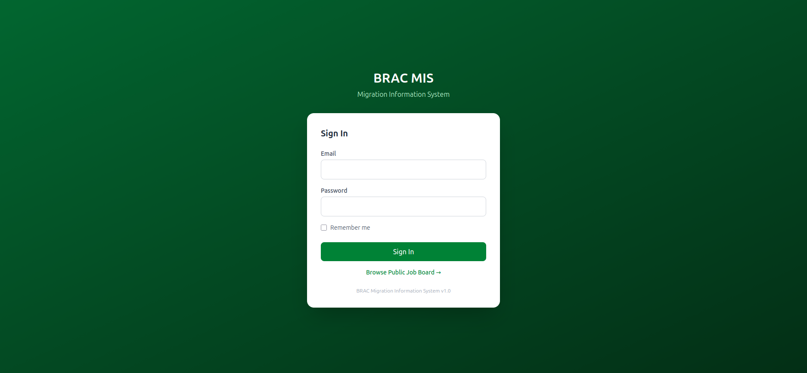

### Admin Dashboard

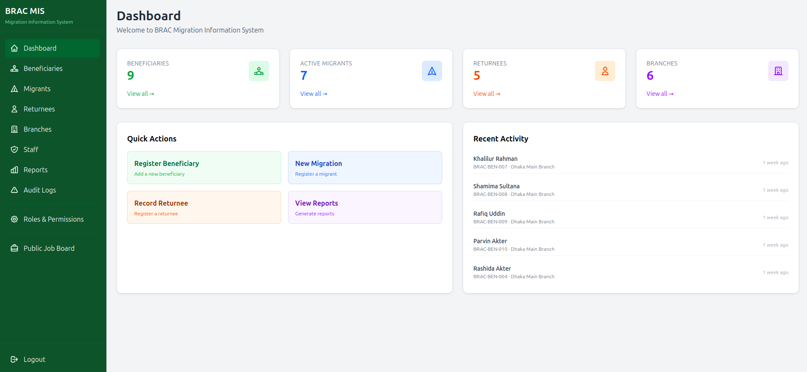

### BRAC Job Board

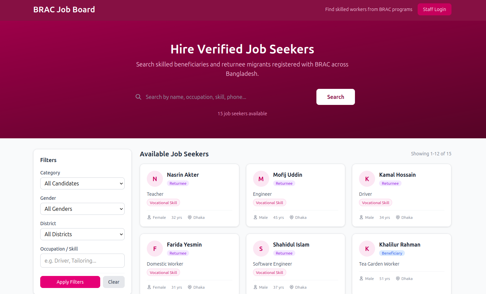

### Branches

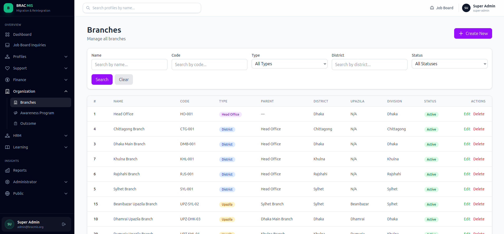

### Staff

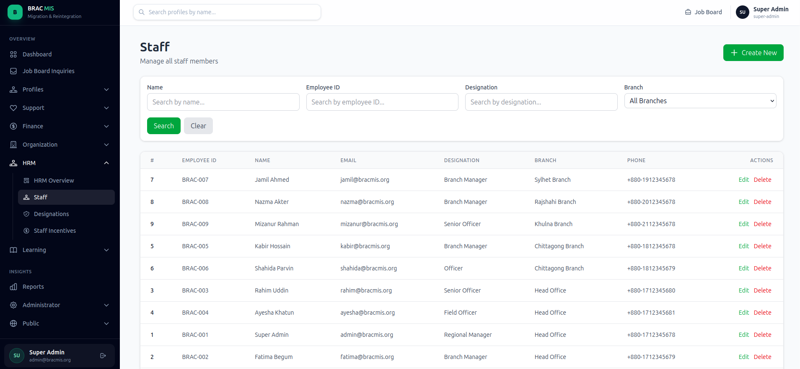

### Reports

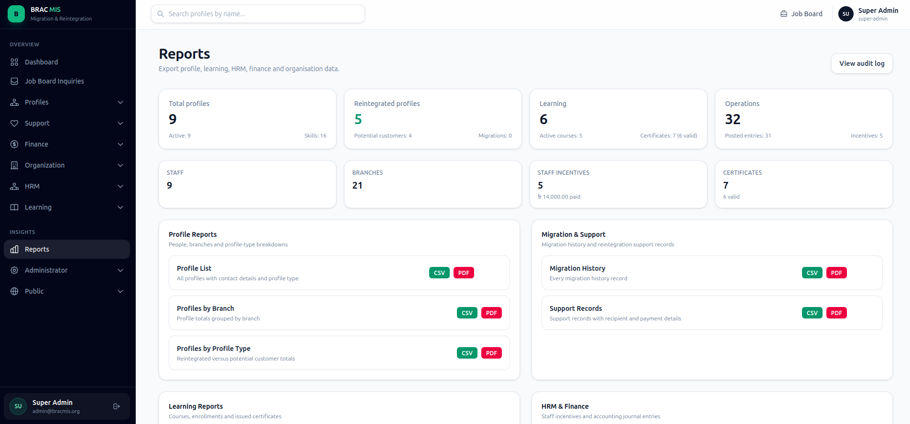

### Audit Logs

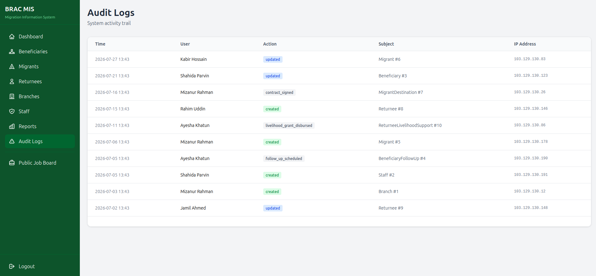

### Roles & Permissions

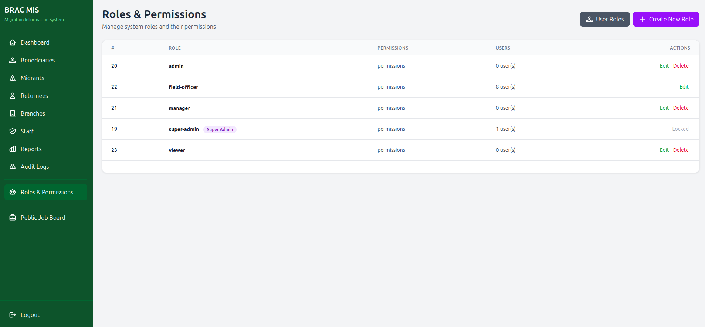

### Edit Role

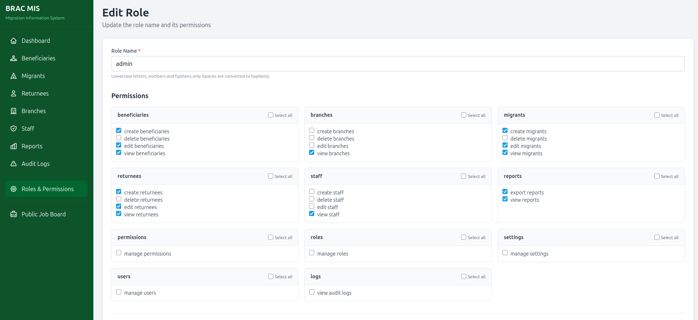

### Permissions

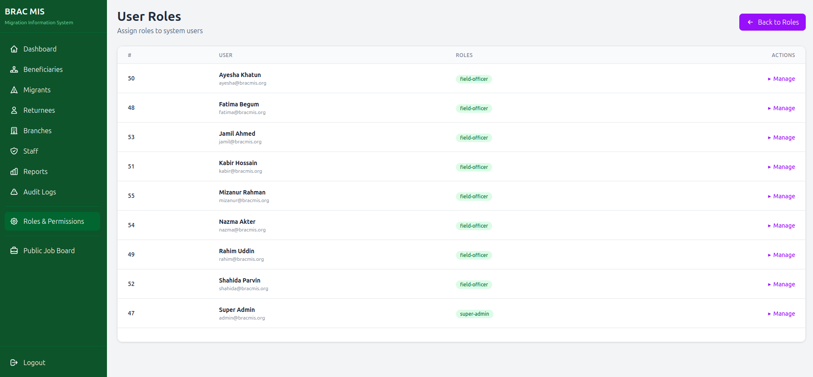

### Assign Roles

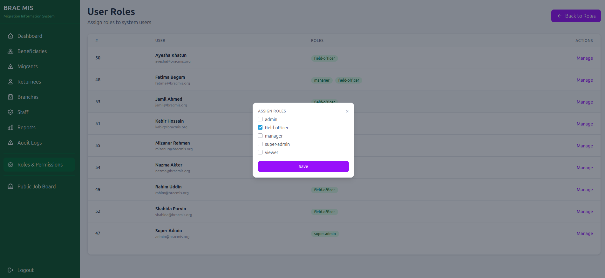

---

## Tech Stack

| Layer            | Technology                      |
| ---------------- | ------------------------------- |
| Backend          | Laravel 13 (PHP 8.3+)           |
| Frontend         | Blade Templates, Tailwind CSS 4 |
| Build Tool       | Vite 8                          |
| Database         | MySQL 8.0 (Docker)              |
| Cache & Sessions | Redis 7.4                       |
| Authentication   | Laravel sessions + Sanctum      |
| RBAC             | spatie/laravel-permission       |
| Exports          | maatwebsite/excel, dompdf       |
| Containerization | Docker + Docker Compose         |

---

## Project Structure

```
brac-mis/
├── docker-compose.yml            # Full local stack (app, nginx, mysql, redis, phpMyAdmin)
├── docker/
│   ├── php/                      # PHP 8.3-FPM Dockerfile + entrypoint
│   └── nginx/                    # nginx site config
├── docs/                         # Case study + AI agent guide
├── screenshots/                  # UI screenshots
└── src/                          # Laravel 13 application
    ├── app/
    │   ├── Http/Controllers/     # 25 web controllers + 4 Api/ controllers
    │   ├── Models/               # 25 Eloquent models
    │   ├── Services/             # Audit, Branch, Dashboard, Report, support/incentive accounting
    │   ├── Jobs/                 # GenerateReport
    │   └── Notifications/        # FollowUpReminder
    ├── database/
    │   ├── migrations/           # 42 migrations
    │   └── seeders/              # Admin user, branches, staff, designations, incentives, demo data, RBAC
    ├── resources/views/          # 82 Blade templates
    └── routes/                   # web.php + api.php
```

---

## Quick Start

### Prerequisites

- Docker & Docker Compose

### Installation

```bash
# 1. Start all containers
docker compose up -d --build

# 2. Install dependencies (inside the app container)
docker exec -it brac_mis_app composer install

# 3. Generate key & run migrations
docker exec -it brac_mis_app php artisan key:generate
docker exec -it brac_mis_app php artisan migrate --force

# 4. Seed demo data & roles
docker exec -it brac_mis_app php artisan db:seed
```

### Access Points

| Service      | URL               |
| ------------ | ----------------- |
| Laravel App  | http://localhost:8087 |
| phpMyAdmin   | http://localhost:8089 |
| MySQL (host) | localhost:3309    |
| Redis (host) | localhost:6383    |

### Default Credentials

| Role  | Email                  | Password |
| ----- | ---------------------- | -------- |
| Admin | admin@bracmis.org      | password |

---

## Database Schema

| Table                           | Purpose                                       |
| ------------------------------- | --------------------------------------------- |
| `users`                         | User profiles with `profile_type` (`reintegrated` or `potential_customer`) |
| `user_skills`                   | Skills, proficiency, experience, and certification per profile |
| `user_migration_histories`      | Destination, employer, job title, visa, dates, and migration status |
| `user_documents`                | Uploaded NID scans, passports, and contracts  |
| `immediate_supports`            | Support records linked to a user profile or unregistered recipient |
| `support_follow_ups`            | Follow-ups with reintegration status          |
| `courses` / `course_enrollments` / `certificates` | Training, enrollment, and verifiable certificate records |
| `awareness_programs` / `awareness_program_outcomes` | Community awareness programs and participant outcomes |
| `accounts` / `journal_entries` / `journal_lines` | Double-entry chart of accounts, journals, and ledger lines |
| `job_board_inquiries`           | Employer contact requests routed through BRAC |
| `branches` / `staff` / `designations` / `staff_incentives` | Organisation structure and HRM data |
| `audit_logs`                    | Full audit trail of all changes               |
| `reports`                       | Export & report generation log                |
| `settings`                      | Administrator-managed application settings    |
| `finances`                      | Legacy income/expense rows migrated into journal entries |

---

## Application Routes

### Public Routes

- `GET /` — Login redirect / dashboard entry
- `GET /login` — Login form
- `GET /job-board` — Public job board (potential customers only)
- `GET /job-board/{user}` — Privacy-safe potential customer profile (404 for any other profile type)
- `POST /job-board/{user}/contact` — BRAC-mediated employer inquiry (throttled, honeypot, consent)
- `GET|POST /certificates/validate` — Certificate validation form and lookup
- `GET /certificates/verify/{code}` — Public certificate verification

### Admin Routes (requires session + permission)

- `GET|POST /users/*` — User profile management (CRUD)
- `GET /skill-access` — Skills and profile-type management
- `POST /skill-access/{user}/profile-type` — Mark as potential customer / revert to reintegrated
- `GET|POST /support/*` — Support records and follow-ups
- `GET|POST /branches/*` — Branch hierarchy management (CRUD)
- `GET /hrm` — HRM overview (staff, designations, branch distribution)
- `GET|POST /staff/*` — Staff management (CRUD)
- `GET|POST /designations/*` — Designation management (CRUD)
- `GET|POST /staff-incentives/*` — Staff incentive management (CRUD)
- `GET|POST /awareness-programs/*` — Awareness programs and outcomes
- `GET|POST /courses/*` — Courses and enrollments
- `GET|POST /certificates/*` — Certificate management
- `GET|POST /finances/*` — Chart of accounts, journal entries, trial balance, income statement, balance sheet, and ledgers
- `GET /job-board/inquiries` — Staff inbox for employer inquiries (`manage job board`)
- `GET /reports` — Reports dashboard (`view reports`)
- `GET /reports/export/{type}/{format}` — CSV / Excel / PDF exports (`export reports` + module/PII gate)
- `GET /audit-logs` — System Activity Logger (audit trail)
- `GET|PUT /settings` — Administrator settings editor

### REST API (requires Sanctum token)

- `POST /api/login` — Obtain API token (`403` for inactive accounts)
- `POST /api/logout` — Revoke the current token
- `GET /api/user` — Authenticated user with roles and permissions
- `GET|POST|PUT|DELETE /api/branches/*` — Branch CRUD (`view` / `create` / `edit` / `delete branches`)
- `GET|POST|PUT|DELETE /api/staff/*` — Staff CRUD (`view` / `create` / `edit` / `delete staff`)
- `GET /api/reports/*` — Profile, migration, and branch performance summaries (`view reports`)
- `GET /api/reports/export/{type}` — Permission-aware report export (`export reports`)

All API routes run through an `active` middleware, so deactivating an account also blocks its existing tokens.

---

## Development

```bash
# Access Laravel container
docker exec -it brac_mis_app bash

# Run artisan commands
docker exec -it brac_mis_app php artisan [command]

# Run tests (PHP is not installed on the host, so run them in the container)
docker exec -it brac_mis_app php artisan test
# or, from the repo root:
docker compose exec -T app php artisan test

# Clear cache
docker exec -it brac_mis_app php artisan config:clear
docker exec -it brac_mis_app php artisan cache:clear
```

---

## License

MIT License

---

## Contributing

1. Fork the repository
2. Create a feature branch
3. Commit your changes
4. Push to the branch
5. Open a Pull Request

---

## Support

For support, please open an issue in the GitHub repository.
